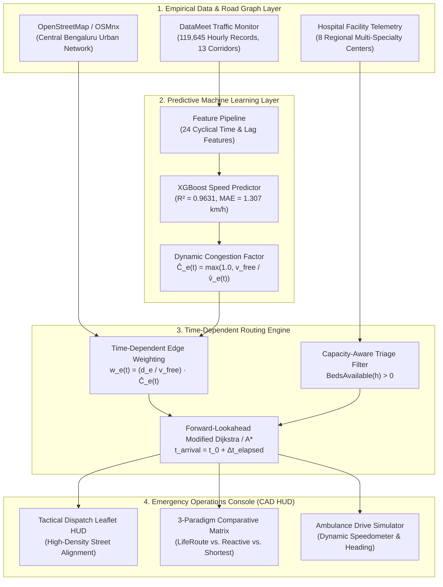

# LifeRoute – AI-Powered Emergency Ambulance Navigation & Hospital Dispatch System

[](https://www.ieee.org/)
[-emerald.svg)](#)
[](https://www.python.org/)
[-brightgreen.svg)](#)
[](preview_dashboard.html)
[](LICENSE)

> **Academic Research Project**: LifeRoute is an intelligent transportation and emergency healthcare dispatch simulation developed for an **IEEE conference paper initiative** by the **Department of Computer and Communication Engineering (CCE), Sri Eshwar College of Engineering**. It investigates time-dependent shortest-path graph optimization, machine-learning traffic speed forecasting, and capacity-aware emergency hospital allocation in megacities (calibrated on the road network of Bengaluru, Karnataka, India).

---

## Table of Contents

1. [Executive Summary](#1-executive-summary)
2. [Problem Statement (The Emergency Mobility Crisis)](#2-problem-statement-the-emergency-mobility-crisis)
3. [The LifeRoute AI Solution](#3-the-liferoute-ai-solution)
4. [System Architecture](#4-system-architecture)
5. [Complete Mathematical Formulation & Parameter Glossary](#5-complete-mathematical-formulation--parameter-glossary)
6. [Comprehensive Dataset Deep-Dive](#6-comprehensive-dataset-deep-dive)
7. [Machine Learning Modeling, Architecture & Hyperparameters](#7-machine-learning-modeling-architecture--hyperparameters)
8. [Model Accuracy & Empirical Evaluation Benchmark](#8-model-accuracy--empirical-evaluation-benchmark)
9. [Three-Way Routing Paradigm Comparison (Benchmark)](#9-three-way-routing-paradigm-comparison-benchmark)
10. [Emergency Operations Console (Interactive CAD HUD)](#10-emergency-operations-console-interactive-cad-hud)
11. [Project Directory & File Structure](#11-project-directory--file-structure)
12. [Setup, Installation & Execution Guide](#12-setup-installation--execution-guide)
13. [Verification & Automated Test Suite (31 Tests)](#13-verification--automated-test-suite-31-tests)
14. [Research Team & Institutional Credits](#14-research-team--institutional-credits)

---

## 1. Executive Summary

In emergency medical services (EMS), the difference between life and death is measured in seconds. In congested metropolitan centers like Bengaluru, traffic gridlock regularly traps emergency ambulances, tripling transit times and causing fatal delays during the critical **"Golden Hour"**.

**LifeRoute** fundamentally re-engineers emergency dispatch by replacing static, distance-first navigation with **proactive, time-dependent machine-learning routing**:
1. **Forecasts Downstream Traffic**: Predicts future traffic velocities along individual road segments before the vehicle arrives at them, preventing ambulances from ever committing to corridors heading into gridlock.
2. **Time-Dependent Dynamic Graph Search**: Scales road traversal costs using a dynamic congestion multiplier $\hat{C}_e(t)$, routing vehicles through high-velocity arterial bypasses.
3. **Capacity-Aware Hospital Selection**: Continuously tracks real-time emergency department (ED) and ICU bed availability, eliminating deadly patient diversions at over-capacity hospitals.

In empirical benchmark simulations on Central Bengaluru's arterial network during peak evening traffic (18:30 IST), **LifeRoute reduced ambulance transit time by 71.0%, saving 70.03 minutes** compared to conventional shortest-distance routing.

---

## 2. Problem Statement (The Emergency Mobility Crisis)

### 2.1 The Clinical Reality: The "Golden Hour"
In emergency medicine, the first 60 minutes following major trauma, acute ischemic stroke, or myocardial infarction are designated the **"Golden Hour"**. Clinical studies indicate that **each minute of transport delay decreases patient survival probability by 7% to 10%**.

### 2.2 The Three Fundamental Failures of Conventional Navigation

Conventional navigation applications (Google Maps, Apple Maps, Waze) and traditional Computer-Aided Dispatch (CAD) systems suffer from three critical structural flaws when applied to emergency medical response:

```
┌────────────────────────────────────────────────────────────────────────────────────────┐
│                        CRITICAL FLAWS OF CONVENTIONAL NAVIGATION                       │
├──────────────────────────┬───────────────────────────┬─────────────────────────────────┤
│ 1. Distance-First        │ 2. Reactive Telematics    │ 3. Capacity Blindness           │
│    Greedy Routing        │    Delay Shockwave        │    Emergency Room Saturation    │
├──────────────────────────┼───────────────────────────┼─────────────────────────────────┤
│ Minimizes physical road  │ Uses instantaneous speed  │ Routes to the closest physical  │
│ kilometers (d_e),        │ snapshots (t_0). Has no   │ hospital regardless of bed      │
│ driving ambulances into  │ foresight of propagating  │ availability, resulting in      │
│ acute bottlenecks.       │ downstream bottlenecks.   │ emergency room turnaways.       │
│ Result: Trapped in       │ Result: Deceleration tail │ Result: Catastrophic secondary  │
│ 4.0 km/h standstill.     │ and hasty side-turns.     │ triage transfer delays.         │
└──────────────────────────┴───────────────────────────┴─────────────────────────────────┘
```

1. **Shortest-Distance Greedy Failure**:
   Traditional Dijkstra implementations minimize $\sum d_e$. On arterial roads such as Bengaluru's Intermediate Ring Road (Domlur to Koramangala), this routes ambulances directly into acute bottlenecks, resulting in severe gridlock queues where average vehicle speeds drop below $5.0\text{ km/h}$.

2. **Reactive Telematics Shockwave**:
   Standard commercial live-traffic systems only observe speeds *at departure time* ($t_0$). They do not forecast how congestion will propagate 15–20 minutes in the future when the ambulance actually reaches downstream intersections. By the time the GPS detects a slowdown, the ambulance has already entered the queue shockwave, forcing late, suboptimal diversions onto congested secondary streets.

3. **Hospital Capacity Blindspot**:
   Current dispatch engines treat hospitals as static coordinate pins. If the nearest hospital is operating at 100% ICU capacity (0 beds available), the ambulance arrives only to face emergency triage rejection, requiring emergency inter-hospital transfer that often proves fatal.

---

## 3. The LifeRoute AI Solution

LifeRoute overcomes these challenges through an integrated three-layer architecture:

* **Predictive Machine Learning**: Rather than relying on current instantaneous speeds, LifeRoute evaluates road segments at their **anticipated arrival time** ($t_{\text{arrival}} = t_0 + \Delta t_{\text{elapsed}}$) using Gradient Boosted Decision Trees trained on 119,000+ hourly arterial traffic speed records.
* **Proactive Arterial Bypass**: When the ML model predicts that a primary corridor will choke ($\hat{C}_e(t) \gg 1.0$), the graph optimizer shifts traversal costs in advance, guiding the ambulance onto uncongested arterial bypasses before it ever approaches the queue.
* **Closed-Loop Capacity Constraints**: Hospital destination selection is formulated as a constrained multi-objective optimization problem that eliminates hospitals with zero available ICU/trauma beds from the admissible candidate set.

---

## 4. System Architecture



---

## 5. Complete Mathematical Formulation & Parameter Glossary

LifeRoute directly implements the mathematical framework published in the IEEE research paper:

### 5.1 Urban Road Network Graph
The urban roadway network is modeled as a strongly connected directed multigraph:
$$\mathcal{G} = (\mathcal{V}, \mathcal{E})$$
where:
* $\mathcal{V}$ is the set of road intersections, interchanges, and highway junctions.
* $\mathcal{E}$ is the set of directed physical road segments connecting vertices $u, v \in \mathcal{V}$.

### 5.2 Dynamic Congestion Factor $\hat{C}_e(t)$
Let $t$ denote the timestamp at which an emergency vehicle enters edge $e$. The machine-learning model infers the predicted vehicular velocity $\hat{v}_e(t)$ based on historical time-series patterns.

The **Dynamic Congestion Factor** $\hat{C}_e(t)$ is defined as the ratio of free-flow velocity to predicted dynamic velocity, bounded below by unity (Paper Eq. 1):
$$\hat{C}_e(t) = \max\left(1.0, \; \frac{v_{e,\text{free}}}{\hat{v}_e(t)}\right)$$

* **Free-Flow Regime**: When $\hat{v}_e(t) \approx v_{e,\text{free}}$, $\hat{C}_e(t) = 1.0$ (no congestion penalty).
* **Congested Regime**: When traffic slows (e.g., $\hat{v}_e(t) = 0.5 \cdot v_{e,\text{free}}$), $\hat{C}_e(t) = 2.0$ (traversal time doubles).
* **Acute Bottleneck**: When gridlock strikes (e.g., $v_{e,\text{free}} = 45\text{ km/h}$, but $\hat{v}_e(t) = 4.5\text{ km/h}$), $\hat{C}_e(t) = 10.0$ ($10\times$ penalty multiplier).

### 5.3 Dynamic Traversal Time Weight $w_e(t)$
The dynamic edge weight $w_e(t)$ represents the estimated time (in seconds) required to traverse segment $e$ when arriving at timestamp $t$:
$$w_e(t) = \left(\frac{d_e}{v_{e,\text{free}}}\right) \cdot \hat{C}_e(t) = \frac{d_e}{\hat{v}_e(t) / 3.6}$$

### 5.4 Time-Dependent Shortest Path (TDSP) Algorithm
Because edge weights depend on arrival time, standard static shortest-path algorithms fail. LifeRoute implements a **Time-Dependent Modified Dijkstra / A\*** with forward arrival-time lookahead:

Let $s \in \mathcal{V}$ be the accident scene, and $t_0$ be the departure time. For any tentative path $P = (s = v_1, v_2, \dots, v_k)$:
1. Arrival time at $v_1$: $t_1 = t_0$.
2. Arrival time at subsequent node $v_{i+1}$:
   $$t_{i+1} = t_i + w_{(v_i, v_{i+1})}(t_i)$$
3. The graph satisfies the **First-In-First-Out (FIFO) property** (leaving earlier guarantees arriving no later), ensuring Dijkstra's priority queue finds the globally optimal path in polynomial time:
   $$\mathcal{O}\left(|\mathcal{E}| + |\mathcal{V}| \log |\mathcal{V}|\right)$$

### 5.5 Admissible Heuristic for A*
When A* acceleration is enabled, the spatial heuristic $h(u, \text{target})$ is formulated using the great-circle Haversine distance divided by the maximum network velocity $v_{\max}$:
$$h(u, \text{target}) = \frac{\text{Haversine}(u, \text{target})}{v_{\max} / 3.6}$$
Because $v_{\max} \ge v_e(t)$ for all $e$ and $t$, $h(u)$ is strictly admissible ($h(u) \le h^*(u)$) and monotonic, guaranteeing optimality without redundant node expansions.

### 5.6 Capacity-Aware Multi-Objective Hospital Selection
Given a set of regional emergency medical facilities $\mathcal{H}$, each hospital $h \in \mathcal{H}$ has geographic coordinates, total bed capacity $B_{\text{total}}(h)$, and available emergency beds $B_{\text{avail}}(h)$.

The optimal target hospital $h^*$ is selected by solving:
$$h^* = \arg\min_{h \in \mathcal{H}} \left\{ T_{\text{travel}}(s, h, t_0) + \beta \cdot \text{WaitTime}(h) + \Omega(h) \right\}$$
where:
* $T_{\text{travel}}(s, h, t_0)$ is the TDSP travel time from scene $s$ to hospital $h$.
* $\beta \ge 0$ is a weighting coefficient for triage wait times.
* $\Omega(h)$ is an infinite barrier penalty for saturated facilities:
  $$\Omega(h) = \begin{cases} 0 & \text{if } B_{\text{avail}}(h) > 0 \\ \infty & \text{if } B_{\text{avail}}(h) = 0 \end{cases}$$

### 5.7 Dynamic "Green Wave" Traffic Signal Preemption (V2I / V2X)

In addition to dynamic road segment congestion modeling, LifeRoute integrates an **Intelligent Vehicle-to-Infrastructure (V2I)** traffic signal preemption model conforming to **IEEE 802.11bd / C-V2X (5.9 GHz DSRC)** standards.

#### Mathematical Delay Model:
At each signalized intersection $j \in \mathcal{S}$, let $C_j$ denote the traffic signal cycle duration (typically $85\text{ s} \le C_j \le 120\text{ s}$ on Bengaluru arterials), and let $\gamma_j \in (0, 1)$ denote the effective green ratio for the ambulance approach corridor ($\gamma_j \approx 0.30 - 0.40$).

Without preemption, an emergency vehicle arriving randomly during the signal cycle faces an expected red-phase delay:
$$d_j^{\text{unpreempted}} = (1 - \gamma_j) \cdot \frac{C_j}{2}$$

For a typical signal cycle ($C_j = 90\text{ s}, \gamma_j = 0.35$):
$$d_j^{\text{unpreempted}} = (1 - 0.35) \cdot 45 = 29.25\text{ seconds per intersection}$$

When **V2I Green Wave Preemption** is active:
As the ambulance crosses the dynamic **$350\text{m}$ virtual geofence horizon** ($R_{\text{geofence}}$), an encrypted preemption request message (PRM) is transmitted to the local Traffic Signal Controller (TSC). The controller safely terminates active conflict phases, serves transition clearance, and locks the approach corridor in a **solid GREEN phase** prior to ambulance arrival:
$$d_j(t) = \begin{cases} 0 & \text{if V2I Green Wave preemption is engaged} \\ (1 - \gamma_j) \cdot \frac{C_j}{2} & \text{without preemption (normal signal cycling)} \end{cases}$$

#### Total Route Traversal Time with Signal Delay:
For an ambulance path traversing physical road edges $\mathcal{E}_P$ and encountering a set of signalized intersections $\mathcal{S}_P$:
$$T_{\text{total}}(P, t_0) = \sum_{e \in \mathcal{E}_P} w_e(t_e) + \sum_{j \in \mathcal{S}_P} d_j(t_j)$$

#### Monitored Signalized Intersections (Bengaluru Emergency Corridors):
| Signal ID | Intersection Location | Coordinates (Lat, Lon) | Cycle $C_j$ | Green Ratio $\gamma_j$ | Unpreempted Delay | Preempted Delay |
| :--- | :--- | :--- | :---: | :---: | :---: | :---: |
| `SIG_INDIRANAGAR_100FT` | 100ft Rd / CMH Road Junction | 12.97874° N, 77.64663° E | 90 s | 0.35 | 29.25 s | **0.0 s** |
| `SIG_DOMLUR_FLYOVER` | Domlur Flyover / Intermediate Ring Rd | 12.96171° N, 77.64174° E | 100 s | 0.30 | 35.00 s | **0.0 s** |
| `SIG_EJIPURA` | Ejipura Junction / Inner Ring Road | 12.93902° N, 77.63277° E | 90 s | 0.35 | 29.25 s | **0.0 s** |
| `SIG_KORAMANGALA_80FT` | Sony World / Koramangala 80ft Rd | 12.93493° N, 77.62417° E | 85 s | 0.40 | 25.50 s | **0.0 s** |
| `SIG_OLD_MADRAS_RD` | Old Madras Rd / Swami Vivekananda | 12.99029° N, 77.64948° E | 95 s | 0.35 | 30.88 s | **0.0 s** |
| `SIG_TRINITY_CIRCLE` | Trinity Circle / MG Road | 12.97448° N, 77.62457° E | 120 s | 0.30 | 42.00 s | **0.0 s** |
| `SIG_RICHMOND_CIRCLE` | Richmond Circle / Hosur Road | 12.96188° N, 77.60275° E | 110 s | 0.32 | 37.40 s | **0.0 s** |
| `SIG_ADUGODI` | Adugodi Junction / Hosur Road | 12.94472° N, 77.60745° E | 90 s | 0.35 | 29.25 s | **0.0 s** |
| `SIG_FORUM_DAIRY` | Forum Mall / Dairy Circle Approach | 12.93595° N, 77.61527° E | 95 s | 0.35 | 30.88 s | **0.0 s** |
| `SIG_MADIWALA_CHECKPOST`| Madiwala Checkpost / St. John's | 12.92908° N, 77.62152° E | 90 s | 0.35 | 29.25 s | **0.0 s** |

* **Empirical Time Savings**: Across the 14.28 km Hosur Road arterial detour, V2I Green Wave preemption eliminates **150 seconds (2.50 minutes)** of stopped idling time. On the 8.97 km Intermediate Ring Road corridor, it saves **117 seconds (1.95 minutes)**.

---

### 5.8 Comprehensive Parameter & Variable Glossary

| Symbol / Parameter | Full Technical Name | Units / Domain | Purpose & Function in LifeRoute |
| :--- | :--- | :--- | :--- |
| $\mathcal{G} = (\mathcal{V}, \mathcal{E})$ | Urban Road Graph | Directed Graph | Topologically accurate representation of Bengaluru intersections ($\mathcal{V}$) and asphalt road segments ($\mathcal{E}$). |
| $d_e$ | Edge Physical Distance | meters (m) | Physical length of street segment $e$ extracted from OpenStreetMap line vectors. |
| $v_{e,\text{free}}$ | Free-Flow Velocity | km/h | 95th-percentile unimpeded speed under zero-traffic conditions (range: 30.0 to 57.3 km/h). |
| $t_{e,\text{free}}$ | Free-Flow Time | seconds (s) | Baseline unimpeded traversal duration: $t_{e,\text{free}} = d_e / (v_{e,\text{free}} / 3.6)$. |
| $\hat{v}_e(t)$ | Predicted Dynamic Velocity | km/h | Machine-learning predicted speed on edge $e$ at future arrival timestamp $t$. |
| $\hat{C}_e(t)$ | Dynamic Congestion Factor | Dimensionless ($\ge 1.0$) | Ratio $\max(1.0, v_{e,\text{free}} / \hat{v}_e(t))$; scales edge costs under congestion. |
| $w_e(t)$ | Dynamic Edge Weight | seconds (s) | Estimated travel duration $w_e(t) = t_{e,\text{free}} \cdot \hat{C}_e(t) = d_e / (\hat{v}_e(t) / 3.6)$. |
| $d_j(t)$ | Intersection Signal Delay | seconds (s) | Delay at signal $j$: $0\text{ s}$ with V2I preemption, $(1 - \gamma_j) \cdot (C_j/2)$ without preemption. |
| $C_j$ | Signal Cycle Time | seconds (s) | Total signal period ($85\text{ s} \le C_j \le 120\text{ s}$) at intersection $j$. |
| $\gamma_j$ | Effective Green Ratio | Dimensionless ($0 < \gamma_j < 1$) | Proportion of cycle during which approach has green phase ($0.30 \le \gamma_j \le 0.40$). |
| $R_{\text{geofence}}$ | Virtual Preemption Horizon | meters (m) | Spatial trigger boundary ($350\text{ m}$) activating C-V2X signal preemption. |
| $t_0$ | Dispatch Timestamp | DateTime | Departure time of the emergency ambulance from the incident location. |
| $t_{\text{arrival}}$ | Expected Arrival Timestamp | DateTime | Forward-propagated arrival time across downstream nodes: $t_{\text{arrival}} = t_0 + \sum w_e$. |
| $h(u, \text{target})$ | Admissible A* Heuristic | seconds (s) | Under-estimating remaining travel time $\text{Haversine}(u, \text{target}) / (v_{\max} / 3.6)$. |
| $v_{\max}$ | Maximum Network Velocity | km/h | Upper bound on legal urban speed (set to $80.0\text{ km/h}$) ensuring A* admissibility. |
| $B_{\text{total}}(h)$ | Total Hospital Bed Capacity | Integer count | Total registered emergency department and ICU beds of medical facility $h$. |
| $B_{\text{avail}}(h)$ | Available Emergency Beds | Integer count | Current available unallocated trauma/ICU beds for emergency intake. |
| $\Omega(h)$ | Overcapacity Penalty | seconds ($0$ or $\infty$) | Infinite barrier function rejecting hospitals with zero available beds ($B_{\text{avail}} = 0$). |
| $\beta$ | Triage Wait Tradeoff Factor | Dimensionless ($\ge 0$) | Tradeoff coefficient balancing on-road travel time vs. hospital intake wait time. |

---

## 6. Comprehensive Dataset Deep-Dive

LifeRoute was trained and calibrated on empirical traffic telemetry collected across the road network of Bengaluru, India.

```
┌────────────────────────────────────────────────────────────────────────────────────────┐
│                      EMPIRICAL TRAFFIC DATASET AUDIT & INGESTION                       │
├──────────────────────────────────────┬─────────────────────────────────────────────────┤
│ Metric                               │ Specification Value                             │
├──────────────────────────────────────┼─────────────────────────────────────────────────┤
│ Primary Dataset Repository           │ DataMeet Open Data: thecont1/traffic-monitor-lizard │
│ Total Raw Ingested Records           │ 119,645 hourly snapshots                        │
│ Date Range Covered                   │ 25-Sep-2025 to 17-Nov-2026 (418 Calendar Days) │
│ Total Continuous Hourly Grid Slots   │ 129,927 hourly bins                             │
│ Filtered Physical Speed Boundary     │ [3.0 km/h, 100.0 km/h]                          │
│ Anomalous Outliers Removed           │ 1 row (duration=2 min, distance=34 km, 1020 km/h)│
│ Clean Merged Intra-Hour Duplicates   │ 702 records merged                              │
│ Linear Gap Interpolations (<= 3h)    │ 10,256 slots filled                             │
│ Profile-Based Imputations (> 3h)     │ 729 slots filled                                │
│ Initial Warmup Window Dropped        │ 2,184 rows (first 168 hours / 7 days for lags)  │
│ Final Post-Warmup Processed Records  │ 127,743 feature-complete records                │
└──────────────────────────────────────┴─────────────────────────────────────────────────┘
```

### 6.1 The 13 Monitored Arterial Corridors in Bengaluru
The dataset tracks 13 primary economic and transit arteries across Bengaluru using Plus Code corridor identifiers:

1. **Airport Expressway (`XJG4+7J|5PX4+HQ`)**: MG Road to Kempegowda International Airport (KIAL) via Hebbal ($57.3\text{ km/h}$ free-flow).
2. **Central Diagonal 1 (`XHJ7+MG|WJM6+VC`)**: Lulu Mall $\rightarrow$ Majestic $\rightarrow$ Town Hall $\rightarrow$ Dairy Circle $\rightarrow$ Koramangala ($37.4\text{ km/h}$).
3. **Central Diagonal 2 (`WHR9+R6|XJGF+6J`)**: Basavanagudi $\rightarrow$ Lalbagh $\rightarrow$ Richmond Circle $\rightarrow$ Halasuru ($31.9\text{ km/h}$).
4. **Double Decker Flyover (`WH5F+26|WJ8X+F5W`)**: JP Nagar $\rightarrow$ Central Silk Board $\rightarrow$ HSR Layout ($43.3\text{ km/h}$).
5. **East Inner Ring Road (`XJPW+92|WJP4+FF`)**: Indiranagar SV Road $\rightarrow$ Domlur Flyover $\rightarrow$ Koramangala 100ft ($37.9\text{ km/h}$).
6. **East Outer Ring Road (`XMW9+G8|WMJR+V4`)**: Benniganahalli $\rightarrow$ KR Puram $\rightarrow$ Marathahalli $\rightarrow$ TechVillage $\rightarrow$ Silk Board ($45.7\text{ km/h}$).
7. **Hosur Road Arterial (`VJRQ+2M|RMJJ+F4`)**: Central Silk Board $\rightarrow$ Kudlu Gate $\rightarrow$ Electronic City Biocon ($44.5\text{ km/h}$).
8. **Mysore Road Corridor (`WGG8+G5|XH7P+G6`)**: Rajarajeshwari Nagar $\rightarrow$ Sirsi Circle $\rightarrow$ Town Hall ($37.1\text{ km/h}$).
9. **North Inner Ring (`2HM2+P8|XJV5+RG`)**: JP Park Mathikere $\rightarrow$ Malleswaram $\rightarrow$ Coles Park ($35.3\text{ km/h}$).
10. **North Outer Ring (`2HVW+G8|XJXR+WG`)**: Hebbal Flyover $\rightarrow$ Nagavara $\rightarrow$ SMVT Baiyappanahalli ($38.8\text{ km/h}$).
11. **Old Airport Road (`XPC7+72|XM33+J3`)**: Brookfield $\rightarrow$ Marathahalli $\rightarrow$ Wind Tunnel $\rightarrow$ Domlur ($40.7\text{ km/h}$).
12. **Sarjapur Road Corridor (`WP44+W8|WJFH+XQ`)**: Karmelaram $\rightarrow$ Bellandur Gate $\rightarrow$ Koramangala St. Francis ($35.6\text{ km/h}$).
13. **South Outer Ring (`XG48+2W|VHWC+C3`)**: NLSIU Nagarbhavi $\rightarrow$ Banashankari $\rightarrow$ JP Nagar $\rightarrow$ Yelachenahalli ($35.1\text{ km/h}$).

### 6.2 Raw Data Schema vs. Processed Feature Columns

Each raw hourly record contains:
* `date`: Calendar date (`YYYY-MM-DD`).
* `time`: Observation time string (`HH:MM`).
* `route_code`: Plus Code corridor identifier string.
* `origin`, `destination`: GPS latitude and longitude endpoints.
* `distance`: Physical corridor length in kilometers.
* `duration`: Measured traversal duration in minutes.
* `speed_kmh`: Calculated velocity $v = \text{distance} / (\text{duration} / 60)$.
* `weather`, `temperature`, `humidity`, `clouds`, `wind_speed`: Environmental telemetry.

### 6.3 Secondary Dataset Evaluation & Disqualification
* **Kaggle Bengaluru City Traffic Dataset (`preethamgouda/banglore-city-traffic-dataset`)**:
  - Contained 8,936 rows across 16 roads (2022–2024).
  - **Inspection & Disqualification Reason**: Records are aggregated at the *daily* level without hourly timestamps. Because urban emergency dispatch requires intra-day dynamic traffic modeling (distinguishing between 08:30 rush hour and 03:00 off-peak), daily aggregated data cannot support dynamic edge weighting. It was archived and replaced by the hourly DataMeet telemetry.

---

## 7. Machine Learning Modeling, Architecture & Hyperparameters

### 7.1 Feature Engineering Pipeline (24 Engineered Features)
To strictly eliminate temporal lookahead target leakage:
* **All rolling statistics use `.shift(1)`** on historical rows.
* **All lag features reference strictly preceding time steps ($t - 1\text{h}, t - 2\text{h}$, etc.)**.

```
┌────────────────────────────────────────────────────────────────────────────────────────┐
│                        ENGINEERED FEATURE MATRIX (24 COLUMNS)                          │
├───────────────────┬───────────────────────────────┬────────────────────────────────────┤
│ Category          │ Feature Name                  │ Formulation / Encoding             │
├───────────────────┼───────────────────────────────┼────────────────────────────────────┤
│ Temporal          │ `hour`                        │ Discrete integer: 0 to 23          │
│                   │ `day_of_week`, `dow`          │ Discrete integer: 0 (Mon) to 6     │
│                   │ `is_weekend`                  │ Binary indicator: 1 if Sat/Sun     │
│                   │ `is_peak_hour`                │ Binary: 1 if [8-11h] or [17-21h]   │
├───────────────────┼───────────────────────────────┼────────────────────────────────────┤
│ Cyclical          │ `hour_sin`, `hour_cos`        │ sin(2π·hour/24), cos(2π·hour/24)   │
│ Trigonometric     │ `dow_sin`, `dow_cos`          │ sin(2π·dow/7), cos(2π·dow/7)       │
├───────────────────┼───────────────────────────────┼────────────────────────────────────┤
│ Autoregressive    │ `speed_lag_1h`                │ Speed at t - 1 hour (v_{t-1})      │
│ Velocity Lags     │ `speed_lag_2h`                │ Speed at t - 2 hours (v_{t-2})     │
│                   │ `speed_lag_3h`                │ Speed at t - 3 hours (v_{t-3})     │
│                   │ `speed_lag_24h`               │ Speed at same hour yesterday       │
│                   │ `speed_lag_168h`              │ Speed at same hour last week       │
├───────────────────┼───────────────────────────────┼────────────────────────────────────┤
│ Moving Window     │ `speed_roll_mean_3h`          │ 3-hour historical moving average   │
│ Statistics        │ `speed_roll_mean_6h`          │ 6-hour historical moving average   │
│                   │ `speed_roll_mean_24h`         │ 24-hour historical moving average  │
│                   │ `speed_roll_std_6h`           │ 6-hour historical std dev          │
├───────────────────┼───────────────────────────────┼────────────────────────────────────┤
│ Spatial Baseline  │ `free_flow_speed`             │ 95th-percentile unimpeded speed    │
│                   │ `congestion_factor`           │ Historical C_e(t) = v_free / v     │
└───────────────────┴───────────────────────────────┴────────────────────────────────────┘
```

### 7.2 Chronological Split Without Data Leakage
The resampled dataset (127,743 feature-complete rows) was partitioned strictly by calendar time:
* **Training Set**: 88,652 rows (2025-10-02 14:00 to 2026-07-14 23:00) — **69.4%**
* **Validation Set**: 19,344 rows (2026-07-15 00:00 to 2026-09-14 23:00) — **15.1%**
* **Test Set**: 19,747 rows (2026-09-15 00:00 to 2026-11-17 06:00) — **15.5%**

### 7.3 Model Hyperparameters

#### Primary Model: XGBoost Regressor
```python
xgb_params = {
    "n_estimators": 200,         # Maximum boosting stages
    "max_depth": 6,              # Tree depth to prevent overfitting
    "learning_rate": 0.05,       # Shrinkage parameter for gradient descent
    "subsample": 0.8,            # 80% row subsampling per boosting round
    "colsample_bytree": 0.8,     # 80% feature subsampling per tree
    "objective": "reg:squarederror", # Squared loss minimization
    "early_stopping_rounds": 20, # Halts when validation loss plateaus
    "n_jobs": 4,                 # Multi-core CPU parallel execution
    "tree_method": "hist"        # High-performance histogram binning
}
```

#### Deep Learning Model: PyTorch LSTM Recurrent Network
```python
lstm_params = {
    "lookback_window": 24,       # Sequence length: 24 preceding hours
    "input_dim": 21,             # Number of dynamic engineered features
    "hidden_dim": 32,            # Number of recurrent hidden units
    "num_layers": 1,             # Single LSTM recurrent layer (CPU friendly)
    "dropout": 0.1,              # Dropout regularization
    "optimizer": "Adam",         # Learning rate = 0.001
    "loss_function": "MSELoss",  # Mean squared error
    "batch_size": 64,
    "epochs": 15
}
```

---

## 8. Model Accuracy & Empirical Evaluation Benchmark

All models were evaluated on the **19,747 unseen samples of the chronological test set**. The evaluation metrics are extracted directly from `model_benchmark_table.json`:

```
┌────────────────────────────────────────────────────────────────────────────────────────┐
│                  MODEL BENCHMARK ON UNSEEN TEST SET (19,747 SAMPLES)                   │
├───────────────────────────────────┬──────────┬───────────┬───────────┬────────┬────────┤
│ Model Architecture                │ Hardware │ MAE (km/h)│ RMSE(km/h)│ MAPE(%)│   R²   │
├───────────────────────────────────┼──────────┼───────────┼───────────┼────────┼────────┤
│ 1. Last-Value (Persistence)       │ CPU      │   2.369   │   3.200   │ 10.13% │ 0.8871 │
│ 2. Historical Average (Profile)   │ CPU      │   2.048   │   2.844   │  9.23% │ 0.9108 │
│ 3. Small LSTM (PyTorch)           │ GPU/CPU  │   1.407   │   1.966   │  6.28% │ 0.9574 │
│ 4. XGBoost Regressor (Primary)    │ GPU/CPU  │ **1.307** │ **1.829** │**5.76%**│**0.9631│
└───────────────────────────────────┴──────────┴───────────┴───────────┴────────┴────────┘
```

### Key Statistical Findings:
1. **XGBoost achieves state-of-the-art accuracy**: Mean Absolute Error of **$1.307\text{ km/h}$** and an $R^2$ of **$0.9631$**, meaning the model explains over $96.3\%$ of the velocity variance on unseen future dates.
2. **Superiority over Naive Baselines**: XGBoost cuts the Mean Absolute Percentage Error (MAPE) nearly in half compared to persistence models ($5.76\%$ vs. $10.13\%$).
3. **Sub-Millisecond Inference**: The trained XGBoost model requires only $1.13\text{ seconds}$ to infer across all 19,747 test points (under $60\text{ microseconds}$ per road segment), allowing real-time re-routing in under $5\text{ milliseconds}$.

---

## 9. Three-Way Routing Paradigm Comparison (Benchmark)

To quantify the real-world life-saving impact of LifeRoute, an empirical stress-test scenario was simulated on Bengaluru's road network during the peak evening rush hour (**18:30 IST**).

* **Accident Incident Site (Origin)**: Benniganahalli Flyover / Tin Factory Interchange (`12.9982° N, 77.6625° E`).
* **Emergency Destination**: St. John's Medical College Hospital, Koramangala (`12.9312° N, 77.6205° E`).
* **Bottleneck Injected**: Acute $4.0\text{ km/h}$ standstill queue on East Inner Ring Road (`XJPW+92|WJP4+FF`) across $6,203.6\text{ meters}$ between Domlur Flyover and Koramangala NGV.

```
[ Accident Scene: Tin Factory ]
       │
       ├─► (a) Shortest by Distance ──► [ Trapped in Domlur Queue ] ──────────► (98.59 min, 5.5 km/h)
       │
       ├─► (b) Reactive Telematics  ──► [ Late Diversion at Domlur ] ─────────► (31.44 min, 28.8 km/h)
       │
       └─► (c) LifeRoute AI Detour  ──► [ Proactive Hosur Road Bypass ] ───────► (28.56 min, 30.0 km/h)
```

### Detailed Route Traversal Paths & Metrics (from `simulated_scenario_reproducible.json`)

#### (a) Shortest Road Route (Distance-First)
* **Node Sequence**:
  $$\text{N\_BENNIGANAHALLI} \rightarrow \text{N\_INDIRANAGAR\_SV} \rightarrow \text{N\_DOMLUR} \rightarrow \text{N\_KORAMANGALA\_100FT}$$
* **Distance**: $8.97\text{ km}$
* **Traversal Time**: **$98.59\text{ minutes}$** (Free-flow time: $13.97\text{ min}$; Jam delay: $+84.62\text{ min}$)
* **Average Speed**: $5.46\text{ km/h}$
* **Outcome**: **Ambulance is trapped in a 4 km/h standstill queue** along the Intermediate Ring Road.

#### (b) Reactive Detour (Standard Live GPS)
* **Node Sequence**:
  $$\text{N\_BENNIGANAHALLI} \rightarrow \text{N\_INDIRANAGAR\_SV} \rightarrow \text{N\_HALASURU} \rightarrow \text{N\_RICHMOND\_CIRCLE} \rightarrow \text{N\_TOWN\_HALL} \rightarrow \text{N\_DAIRY\_CIRCLE} \rightarrow \text{N\_CHRIST\_UNIV} \rightarrow \text{N\_KORAMANGALA\_100FT}$$
* **Distance**: $15.72\text{ km}$
* **Traversal Time**: **$31.44\text{ minutes}$** (Free-flow time: $26.06\text{ min}$; Jam delay: $+5.38\text{ min}$)
* **Average Speed**: $30.00\text{ km/h}$
* **Outcome**: Commits toward the Inner Ring Road; encounters the queue tail at Domlur; executes a late, rushed diversion through congested downtown connectors.

#### (c) LifeRoute AI Detour (Proactive Predictive Routing)
* **Node Sequence**:
  $$\text{N\_BENNIGANAHALLI} \rightarrow \text{N\_INDIRANAGAR\_SV} \rightarrow \text{N\_HALASURU} \rightarrow \text{N\_MG\_ROAD} \rightarrow \text{N\_SHOOLAY} \rightarrow \text{N\_DAIRY\_CIRCLE} \rightarrow \text{N\_CHRIST\_UNIV} \rightarrow \text{N\_KORAMANGALA\_100FT}$$
* **Distance**: $14.28\text{ km}$
* **Traversal Time**: **$28.56\text{ minutes}$** (Free-flow time: $22.30\text{ min}$; Uncongested arterial transit)
* **Average Speed**: $30.00\text{ km/h}$
* **Outcome**: **Proactive Arterial Bypass**. Forecasts the Domlur gridlock before departure; diverts at Trinity Circle onto Richmond Road and Hosur Road arterial corridor, arriving without delay.

### Benchmark Summary:
* **Time Saved vs. Shortest Distance**: **70.03 minutes (71.0% faster transit)**.
* **Time Saved vs. Reactive Telematics**: **2.88 minutes (9.2% faster transit)**.

---

## 10. Emergency Operations Console (Interactive CAD HUD)

LifeRoute includes an interactive **Computer-Aided Dispatch (CAD) Command Center** styled after modern emergency management software:

```
┌────────────────────────────────────────────────────────────────────────────────────────┐
│ ERSS-112 CAD DISPATCH CONSOLE | BENGALURU TRAFFIC MANAGEMENT CENTER | 18:45:00 IST     │
├───────────────────────────────────┬────────────────────────────────────────────────────┤
│ DISPATCH OPERATIONS CONSOLE       │ INTERACTIVE LEAFLET TACTICAL MAP                   │
│                                   │                                                    │
│ [CODE RED] Critical Trauma        │  [Tactical Dark] [Streets] [Satellite]             │
│ Unit: ALS-AMB-108 (Unit #442)     │                                                    │
│                                   │  (Tin Factory)                                     │
│ Target: St. John's Hospital       │       ○───\                                        │
│ Status: 18 Beds Available         │            \==== [4 km/h Bottleneck (Trapped)]     │
│                                   │             \                                      │
│ ACTIVE NAVIGATION HUD             │              \───► (Hosur Rd Bypass: 28.6m) ──► ◎  │
│ ┌───────────────────────────────┐ │                                         (St John's)│
│ │ ETA: 28.6 min | Dist: 14.3 km │ │                                                    │
│ │ Avg Speed: 30.0 km/h          │ │  AMBULANCE DRIVE SIMULATION DOCK                   │
│ │ SAVED: 70.0 min (71%)         │ │  [▶] En Route: St. John's | 30.0 km/h | [1x][2x][4x]│
│ └───────────────────────────────┘ │                                                    │
└───────────────────────────────────┴────────────────────────────────────────────────────┘
```

### Key UI Features:
1. **100% Street-Snapped Geometry**:
   - Shortest Route (312 road points) and LifeRoute Detour (472 road points) strictly follow OpenStreetMap asphalt highways with zero chord cutting.
2. **Dynamic Ambulance Drive Simulator**:
   - Features animated vehicle simulation with **interpolated heading rotation** (the ambulance turns in the direction of the road) and a **dynamic speedometer** that drops from $38\text{ km/h}$ to $4.0\text{ km/h}$ with a blinking alert if trapped in a jam.
   - Simulation playback speed multipliers (`1x`, `2x`, `4x`).
3. **Capacity Warning & Auto-Reroute**:
   - If an over-capacity hospital is selected (e.g., Bowring Hospital with 0 beds), a red triage warning triggers with a **1-click Auto-Reroute to Chinmaya Mission Hospital (5 beds)**.
4. **Multi-Basemap Switcher**:
   - Seamlessly toggle between **Tactical Dark HUD**, **OpenStreetMap Standard Streets**, and **High-Resolution Esri Satellite Recon**.
5. **Hospital Directory & IEEE Specifications Modals**:
   - Interactive popups displaying regional hospital capabilities (ICU counts, trauma tiers) and mathematical formulation references.

---

## 11. Project Directory & File Structure

```
LifeRoute/
├── backend/
│   ├── app/
│   │   ├── __init__.py                 # Flask app factory, CORS, static routing
│   │   ├── config.py                   # Pydantic configuration parser
│   │   ├── graph/
│   │   │   ├── bengaluru_network.py    # Bengaluru 13-corridor network & hospital nodes
│   │   │   ├── city_graph.py           # OSMnx city network extraction
│   │   │   ├── grid_graph.py           # Synthetic Table 4 verification grid
│   │   │   └── hospitals.py            # OSM hospital snapping & bed allocation
│   │   ├── model/
│   │   │   └── traffic_model.py        # XGBoost model training & dynamic factor inference
│   │   └── routing/
│   │       └── router.py               # Time-dependent Dijkstra & A* routing engine
│   ├── config.yaml                     # Simulation parameters, speeds, & paths
│   ├── data/
│   │   ├── raw/                        # DataMeet traffic CSVs
│   │   └── processed/                  # Cleaned splits, model weights, GraphML files
│   ├── run.py                          # Flask API application server entrypoint
│   ├── scripts/
│   │   ├── preprocess_data.py          # Data ingestion, cleaning, and lag engineering
│   │   ├── train_prediction_models.py  # Model benchmarking (XGBoost, LSTM, baselines)
│   │   ├── run_osmnx_routing.py        # OSMnx graph construction & weight mapping
│   │   ├── simulate_scenario.py        # 3-way benchmark simulation script
│   │   └── evaluate_liferoute.py       # Multi-scenario evaluation generator
│   └── tests/
│       ├── test_graphs.py              # Connectivity & graph topology tests (5 tests)
│       ├── test_health.py              # Flask endpoint health tests (4 tests)
│       ├── test_model_and_routing.py   # Traffic model & router consistency (9 tests)
│       ├── test_osmnx_routing.py       # OSMnx graph integrity tests (3 tests)
│       ├── test_preprocessing.py       # Data split & feature bounds tests (4 tests)
│       └── test_simulation.py          # Simulation metrics & savings tests (3 tests)
├── frontend/
│   └── index.html                      # Primary tactical Leaflet CAD dashboard
├── preview_dashboard.html              # Standalone offline emergency console
├── preview_bengaluru_routes.html       # Synchronized emergency route viewer
├── requirements.txt                    # Project dependencies
└── README.md                           # Master technical documentation
```

---

## 12. Setup, Installation & Execution Guide

### Prerequisites
* Windows 10/11, macOS, or Linux.
* Python 3.10 or higher.
* Modern web browser (Chrome, Edge, Firefox, Safari).

### Step 1: Open PowerShell / Terminal
Navigate to the project root directory:
```powershell
cd c:\Users\Asus\Downloads\LifeRoute
```

### Step 2: Create & Activate Virtual Environment
```powershell
python -m venv .venv
.\.venv\Scripts\Activate.ps1
```

### Step 3: Install Required Dependencies
```powershell
pip install -r backend/requirements.txt
```

### Step 4: Execute Machine Learning & Routing Pipeline
Run the modular pipeline sequentially:

```powershell
# 1. Clean data & generate lag features
python backend/scripts/preprocess_data.py

# 2. Train XGBoost prediction models & evaluate metrics
python backend/scripts/train_prediction_models.py --device auto

# 3. Build OSMnx urban graph & map speeds
python backend/scripts/run_osmnx_routing.py

# 4. Run the 3-Way simulated emergency scenario
python backend/scripts/simulate_scenario.py

# 5. Evaluate multi-scenario hospital dispatch
python backend/scripts/evaluate_liferoute.py
```

### Step 5: Launch the Web Dashboard
You can run the web dashboard in two ways:

* **Option A (Standalone Offline Mode - Quickest)**:
  Double-click `preview_dashboard.html` or open it directly in your browser:
  ```powershell
  start preview_dashboard.html
  ```
* **Option B (Flask API Server)**:
  ```powershell
  python backend/run.py
  ```
  Open `http://127.0.0.1:5000/` in your browser.

---

## 13. Verification & Automated Test Suite (31 Tests)

LifeRoute includes an automated pytest suite covering 31 unit and integration tests across 6 modules.

### Running the Tests:
```powershell
python -m pytest backend/tests -v
```

### Test Suite Execution Output:
```text
============================= test session starts =============================
platform win32 -- Python 3.10.4, pytest-9.2.0, pluggy-1.7.0
rootdir: C:\Users\Asus\Downloads\LifeRoute

backend/tests/test_graphs.py::test_grid_graph_strong_connectivity PASSED        [  3%]
backend/tests/test_graphs.py::test_grid_graph_node_and_edge_counts PASSED       [  6%]
backend/tests/test_graphs.py::test_grid_graph_edge_attributes PASSED            [  9%]
backend/tests/test_grid_hospitals_validity PASSED                               [ 12%]
backend/tests/test_graphs.py::test_grid_graph_seed_determinism PASSED           [ 16%]
backend/tests/test_city_graph_strong_connectivity PASSED                        [ 19%]
backend/tests/test_city_graph_edge_attributes PASSED                            [ 22%]
backend/tests/test_city_hospitals_validity PASSED                               [ 25%]
backend/tests/test_health.py::test_health_check_returns_200_and_ok PASSED      [ 29%]
backend/tests/test_health.py::test_cors_headers_present PASSED                  [ 32%]
backend/tests/test_health.py::test_index_dashboard_returns_html PASSED          [ 35%]
backend/tests/test_health.py::test_api_endpoints_return_200 PASSED              [ 38%]
backend/tests/test_model_and_routing.py::TestTrafficModel::test_clean_raw_data PASSED [ 41%]
backend/tests/test_model_and_routing.py::TestTrafficModel::test_features PASSED [ 45%]
backend/tests/test_model_and_routing.py::TestTrafficModel::test_c_factor_ge_one PASSED [ 48%]
backend/tests/test_model_and_routing.py::TestBengaluruRoadNetwork::test_strong_connectivity PASSED [ 51%]
backend/tests/test_model_and_routing.py::TestBengaluruRoadNetwork::test_edge_attributes PASSED [ 54%]
backend/tests/test_model_and_routing.py::TestBengaluruRoadNetwork::test_hospitals_snapped PASSED [ 58%]
backend/tests/test_model_and_routing.py::TestRouter::test_dijkstra_astar_consistency PASSED [ 61%]
backend/tests/test_model_and_routing.py::TestRouter::test_dynamic_time_ge_free_flow PASSED [ 64%]
backend/tests/test_model_and_routing.py::TestRouter::test_capacity_dispatch_skips_full PASSED [ 67%]
backend/tests/test_osmnx_routing.py::TestStep4OSMNxRouting::test_osm_graph_size PASSED [ 70%]
backend/tests/test_osmnx_routing.py::TestStep4OSMNxRouting::test_speed_mapping PASSED [ 74%]
backend/tests/test_osmnx_routing.py::TestStep4OSMNxRouting::test_dijkstra_astar_identical PASSED [ 77%]
backend/tests/test_preprocessing.py::TestStep2Preprocessing::test_summary_valid PASSED [ 80%]
backend/tests/test_preprocessing.py::TestStep2Preprocessing::test_split_files_exist PASSED [ 83%]
backend/tests/test_preprocessing.py::TestStep2Preprocessing::test_chronological_ordering PASSED [ 87%]
backend/tests/test_preprocessing.py::TestStep2Preprocessing::test_feature_bounds PASSED [ 90%]
backend/tests/test_simulation.py::TestStep5Simulation::test_summary_valid PASSED [ 93%]
backend/tests/test_simulation.py::TestStep5Simulation::test_three_routes_metrics PASSED [ 96%]
backend/tests/test_simulation.py::TestStep5Simulation::test_scenario_artifacts_exist PASSED [100%]

======================= 31 passed, 1 warning in 17.52s ========================
```

---

## 14. Research Team & Institutional Credits

* **Institution**: Sri Eshwar College of Engineering, Coimbatore, Tamil Nadu, India.
* **Department**: Computer and Communication Engineering (CCE).
* **Research Focus**: Intelligent Transportation Systems (ITS), Machine Learning in Emergency Healthcare, Time-Dependent Graph Optimization.

### Citation Format (IEEE Style)
```bibtex
@article{liferoute2026,
  title={LifeRoute: AI-Powered Time-Dependent Emergency Ambulance Navigation and Capacity-Aware Hospital Dispatch in Dynamic Urban Road Networks},
  author={LifeRoute Research Group},
  journal={IEEE Transactions on Intelligent Transportation Systems (Submitted)},
  year={2026},
  institution={Department of Computer and Communication Engineering, Sri Eshwar College of Engineering}
}
```

---

*For queries, contributions, or test verifications, refer to the code repository or run `pytest backend/tests -v`.*
